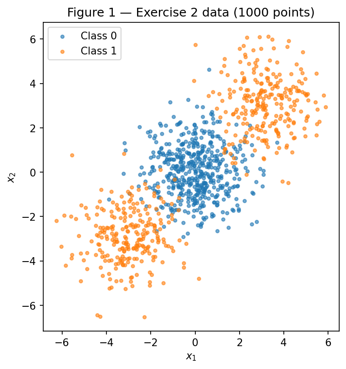
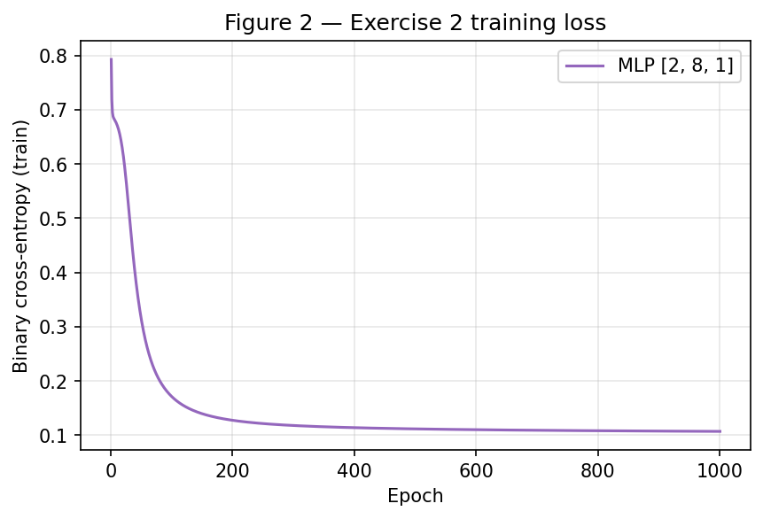
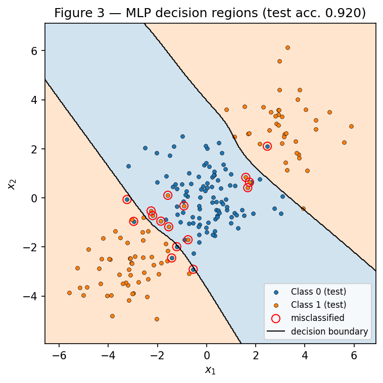
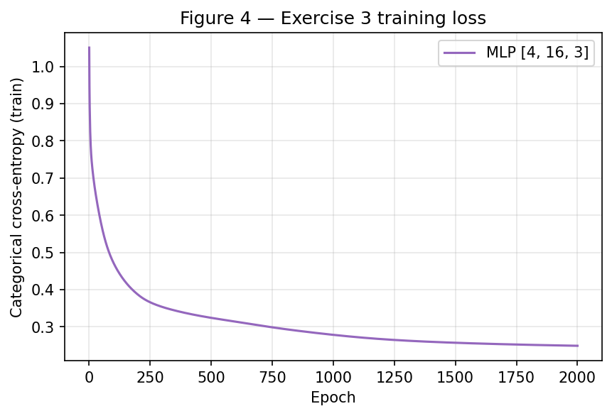
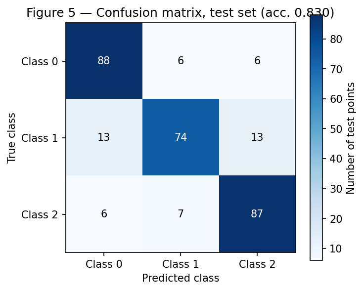
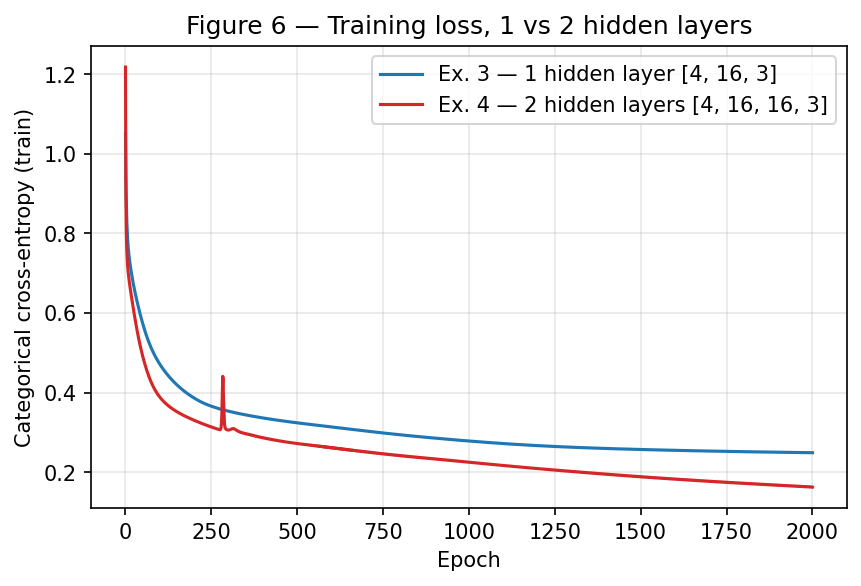

# MLP — Multi-Layer Perceptrons from Scratch

**Approach.** Everything in this report is produced by a single script,
[`code/mlp.py`](code/mlp.py), which creates **one** generator
`rng = np.random.default_rng(42)` and uses it for every weight initialization, in the order of
the statement: Exercise 2 network → Exercise 3 network → Exercise 4 network. The datasets come from
`make_blobs` / `make_classification` / `train_test_split` with `random_state=42`, exactly as
specified. Running it from the repository root

```shell
python docs/exercises/mlp/code/mlp.py
```

regenerates the six figures in `figures/` and every number quoted below
(`figures/results.json`); two consecutive runs produce byte-identical outputs.
The network — activations, losses, forward pass, backward pass, update and training loop — is a
single NumPy class written from scratch. scikit-learn appears only where the statement allows it:
the two data generators, the split, `confusion_matrix` and the `LogisticRegression` baselines.
The backward pass was checked against finite differences on a small 2-hidden-layer network, for both
output types (largest absolute difference $\approx 2 \times 10^{-10}$).

**Challenges.** The first was making one backward pass serve both the binary and the multi-class
tasks; it works because sigmoid + binary cross-entropy and softmax + categorical cross-entropy have
the *same* output-layer gradient, $\hat{\mathbf{y}} - \mathbf{y}$ (derived in **3.B**). The second
was Exercise 4: a single run says the deeper network is clearly better (86.7% against 83.0%),
but repeating both with three seeds shows that difference is mostly noise from the initialization —
which is exactly why the statement asks for several seeds.

??? note "Setup (imports, seed, helpers)"

    ```python
    --8<-- "docs/exercises/mlp/code/mlp.py:setup"
    ```

## Exercise 1 — Backpropagation by hand

Network: $\mathbf{x} \in \mathbb{R}^2 \to$ 2 hidden tanh neurons $\to$ 1 tanh output, loss
$L = (y - \hat{y})^2$. Given values:

$$
\mathbf{x} = \begin{bmatrix} 0.5 \\ -0.2 \end{bmatrix},\quad y = 1.0,\quad
\mathbf{W}^{(1)} = \begin{bmatrix} 0.3 & -0.1 \\ 0.2 & 0.4 \end{bmatrix},\quad
\mathbf{b}^{(1)} = \begin{bmatrix} 0.1 \\ -0.2 \end{bmatrix},\quad
\mathbf{W}^{(2)} = \begin{bmatrix} 0.5 & -0.3 \end{bmatrix},\quad
b^{(2)} = 0.2,\quad \eta = 0.3
$$

Row $i$ of $\mathbf{W}^{(1)}$ holds the weights entering hidden neuron $i$. All values are
rounded to 4 decimals for display, but each step uses the unrounded previous value (the NumPy
check at the end of this section reproduces every number).

### A — Forward pass

**Hidden pre-activation** $\mathbf{z}^{(1)} = \mathbf{W}^{(1)} \mathbf{x} + \mathbf{b}^{(1)}$:

$$
z^{(1)}_1 = 0.3(0.5) + (-0.1)(-0.2) + 0.1 = 0.15 + 0.02 + 0.1 = 0.2700
$$

$$
z^{(1)}_2 = 0.2(0.5) + 0.4(-0.2) - 0.2 = 0.10 - 0.08 - 0.2 = -0.1800
$$

**Hidden activation** $\mathbf{h}^{(1)} = \tanh(\mathbf{z}^{(1)})$:

$$
h^{(1)}_1 = \tanh(0.27) = 0.2636, \qquad h^{(1)}_2 = \tanh(-0.18) = -0.1781
$$

**Output pre-activation** $u^{(2)} = \mathbf{W}^{(2)} \mathbf{h}^{(1)} + b^{(2)}$:

$$
u^{(2)} = 0.5(0.2636) + (-0.3)(-0.1781) + 0.2 = 0.1318 + 0.0534 + 0.2 = 0.3852
$$

**Output and loss**:

$$
\hat{y} = \tanh(0.3852) = 0.3672, \qquad
L = (1.0 - 0.3672)^2 = 0.6328^2 = 0.4004
$$

### B — Backward pass

We use $\tanh'(a) = 1 - \tanh^2(a)$, so each derivative of a tanh layer is computed from its own
output.

**Output pre-activation.**

$$
\frac{\partial L}{\partial \hat{y}} = -2(y - \hat{y}) = -2(0.6328) = -1.2655
$$

$$
\frac{\partial L}{\partial u^{(2)}} = \frac{\partial L}{\partial \hat{y}} \cdot (1 - \hat{y}^2)
= -1.2655 \times (1 - 0.3672^2) = -1.2655 \times 0.8651 = -1.0948
$$

**Output-layer gradients.** Since $u^{(2)} = \sum_i W^{(2)}_i h^{(1)}_i + b^{(2)}$,
$\partial u^{(2)} / \partial W^{(2)}_i = h^{(1)}_i$ and $\partial u^{(2)} / \partial b^{(2)} = 1$:

$$
\frac{\partial L}{\partial \mathbf{W}^{(2)}} = \frac{\partial L}{\partial u^{(2)}} \, \mathbf{h}^{(1)}
= -1.0948 \times [0.2636,\ -0.1781] = [-0.2886,\ 0.1950]
$$

$$
\frac{\partial L}{\partial b^{(2)}} = \frac{\partial L}{\partial u^{(2)}} = -1.0948
$$

**Propagated to the hidden layer.** $\partial u^{(2)} / \partial h^{(1)}_i = W^{(2)}_i$:

$$
\frac{\partial L}{\partial \mathbf{h}^{(1)}} = \frac{\partial L}{\partial u^{(2)}} \, \mathbf{W}^{(2)}
= -1.0948 \times [0.5,\ -0.3] = [-0.5474,\ 0.3284]
$$

$$
\frac{\partial L}{\partial \mathbf{z}^{(1)}} = \frac{\partial L}{\partial \mathbf{h}^{(1)}} \odot (1 - (\mathbf{h}^{(1)})^2)
= [-0.5474 \times 0.9305,\ \ 0.3284 \times 0.9683] = [-0.5094,\ 0.3180]
$$

(with $1 - 0.2636^2 = 0.9305$ and $1 - 0.1781^2 = 0.9683$).

**Hidden-layer gradients.** $\partial z^{(1)}_i / \partial W^{(1)}_{ij} = x_j$ and
$\partial z^{(1)}_i / \partial b^{(1)}_i = 1$, so the weight gradient is an outer product:

$$
\frac{\partial L}{\partial \mathbf{W}^{(1)}} = \frac{\partial L}{\partial \mathbf{z}^{(1)}} \, \mathbf{x}^\top
= \begin{bmatrix} -0.5094 \times 0.5 & -0.5094 \times (-0.2) \\ 0.3180 \times 0.5 & 0.3180 \times (-0.2) \end{bmatrix}
= \begin{bmatrix} -0.2547 & 0.1019 \\ 0.1590 & -0.0636 \end{bmatrix}
$$

$$
\frac{\partial L}{\partial \mathbf{b}^{(1)}} = \frac{\partial L}{\partial \mathbf{z}^{(1)}} = [-0.5094,\ 0.3180]
$$

### C — Parameter update

Gradient descent, $\theta \leftarrow \theta - \eta \, \partial L / \partial \theta$ with $\eta = 0.3$:

| Parameter | Old | Gradient | New $= \text{old} - 0.3 \times \text{grad}$ |
|:---|---:|---:|---:|
| $W^{(1)}_{11}$ | 0.3000 | −0.2547 | **0.3764** |
| $W^{(1)}_{12}$ | −0.1000 | 0.1019 | **−0.1306** |
| $W^{(1)}_{21}$ | 0.2000 | 0.1590 | **0.1523** |
| $W^{(1)}_{22}$ | 0.4000 | −0.0636 | **0.4191** |
| $b^{(1)}_1$ | 0.1000 | −0.5094 | **0.2528** |
| $b^{(1)}_2$ | −0.2000 | 0.3180 | **−0.2954** |
| $W^{(2)}_1$ | 0.5000 | −0.2886 | **0.5866** |
| $W^{(2)}_2$ | −0.3000 | 0.1950 | **−0.3585** |
| $b^{(2)}$ | 0.2000 | −1.0948 | **0.5284** |

(The statement counts "eight parameters" grouping the bias vector; there are nine scalars.)

**Does the loss go down?** Yes. A second forward pass with the new parameters gives
$\hat{y} = 0.7112$ and $L = (1 - 0.7112)^2 = 0.0834$, against $0.4004$ before — the loss drops by
a factor of about 5. The reason: every parameter moved against its gradient, i.e. in the direction
that, to first order, decreases $L$ — the predicted change is
$-\eta \lVert \nabla L \rVert^2 < 0$. Every step pushes $\hat{y}$ up toward the target $y = 1$:
the output bias rises, the weight from the positive hidden unit grows, the weight from the negative
one becomes more negative, and the hidden units themselves move so that $h_1$ grows and $h_2$
becomes more negative. Here $\eta = 0.3$ is small enough that the first-order picture holds (it is
always possible to overshoot with a large enough step, but not at this size).

??? example "NumPy check of the hand computation"

    ```python
    --8<-- "docs/exercises/mlp/code/mlp.py:ex1"
    ```

    Output (rounded to 4 decimals) matches every value above; it is stored under `ex1` in
    `figures/results.json`.

## Exercise 2 — Binary classification a line cannot do

### A — Data

```python
--8<-- "docs/exercises/mlp/code/mlp.py:ex2a"
```

Class 0 is the 500 points of the central blob at $(0, 0)$; class 1 is the 250 + 250 points of the
blobs at $(3, 3)$ and $(-3, -3)$, so the two classes are balanced (500 / 500). The stratified split
leaves 800 training and 200 test points.



*Figure 1 — The 1000 points coloured by class. Class 1 sits on both sides of class 0, along the
diagonal.*

### B — Linear baseline

```python
--8<-- "docs/exercises/mlp/code/mlp.py:ex2b"
```

**Test accuracy of the logistic regression: 0.4750 (47.5%)** — worse than a coin flip.

### C — MLP from scratch

The whole network is one class. The layer sizes are the first argument, so the same code builds the
2-input binary network here and the 4-input, 3-output networks of Exercises 3 and 4:

```python
--8<-- "docs/exercises/mlp/code/mlp.py:mlp"
```

- **Forward pass**: $\mathbf{a}^{(0)} = \mathbf{X}$,
  $\mathbf{a}^{(l)} = \tanh(\mathbf{a}^{(l-1)} \mathbf{W}^{(l)} + \mathbf{b}^{(l)})$ for the hidden
  layers, sigmoid on the single output unit.
- **Loss**: binary cross-entropy
  $L = -\frac{1}{N} \sum_n \left[ y_n \log \hat{y}_n + (1 - y_n) \log(1 - \hat{y}_n) \right]$.
- **Backward pass**: with $\hat{y} = \sigma(u)$ and $\sigma'(u) = \hat{y}(1 - \hat{y})$,
  $$
  \frac{\partial L_n}{\partial u_n} = \left( -\frac{y_n}{\hat{y}_n} + \frac{1 - y_n}{1 - \hat{y}_n} \right) \hat{y}_n (1 - \hat{y}_n) = \hat{y}_n - y_n ,
  $$
  so the output delta is $(\hat{\mathbf{y}} - \mathbf{y}) / N$. Each layer then gives
  $\partial L / \partial \mathbf{W}^{(l)} = (\mathbf{a}^{(l-1)})^\top \delta^{(l)}$,
  $\partial L / \partial \mathbf{b}^{(l)} = \sum_n \delta^{(l)}_n$, and passes
  $\delta^{(l-1)} = (\delta^{(l)} \mathbf{W}^{(l)\top}) \odot (1 - (\mathbf{a}^{(l-1)})^2)$
  down — the same chain rule as Exercise 1, written for a batch.
- **Update**: full-batch gradient descent, one step per epoch.

```python
--8<-- "docs/exercises/mlp/code/mlp.py:ex2c"
```

| Setting | Value |
|:---|:---|
| Architecture | $[2, 8, 1]$ — 2 inputs, one hidden layer of 8 tanh units, 1 sigmoid output (33 parameters) |
| Initialization | $W \sim \mathcal{N}(0, 1/\text{fan-in})$, $b = 0$, drawn from the shared `rng` |
| Learning rate | 0.5 (full batch) |
| Epochs | 1000 |
| Training loss | 0.7930 (epoch 1) → 0.1070 (epoch 1000) |
| Train accuracy | 0.9650 |
| **Test accuracy** | **0.9200** (16 of 200 test points wrong) |



*Figure 2 — Training loss per epoch: a fast drop in the first ~100 epochs while the network finds the
two boundaries, then a slow tail as they are fine-tuned.*



*Figure 3 — Decision regions of the trained MLP over the test points (shaded: predicted class;
black line: decision boundary; red circles: misclassified test points).*

### D — Analysis

**Why the line scores below 50%.** Class 1 surrounds class 0 symmetrically: its two blobs are
centred at $(3, 3)$ and $(-3, -3)$, so its mean is the origin — the same as class 0's. Any line puts
one class-1 blob on each side, or both on the same side as the central blob; either way it gets
roughly half of the points right, and nothing in the data favours one orientation. Logistic
regression, unable to find a useful direction, ends up almost flat: its weights are
$[0.0296,\ 0.0015]$ with intercept $-0.0031$, so the predicted probability stays close to $0.5$
everywhere and the label is decided by a nearly arbitrary line through the centre. On the test set
it predicts class 1 for 44.5% of the points and gets 53% of class 0 and 42% of class 1 right —
47.5% overall. Below 50% is just the sampling noise around a chance-level classifier.

**Why the MLP exceeds 90%.** Each hidden tanh unit computes a soft half-plane, a line in the input
space. With several of them the output layer can combine lines — "above line A **or** below line B"
— which a single linear unit cannot do.

**The class-1 region in Figure 3** is **two separate, disconnected regions**: one in the upper-right
and one in the lower-left, separated by a diagonal band of class 0 that runs from the upper-left to
the lower-right corner and contains the central blob. Two roughly parallel boundaries, each
perpendicular to the $(1, 1)$ direction, cut the plane into three strips; the middle one is class 0
and both outer ones are class 1 (54.7% of the plotted grid is class 1). The remaining errors are the
points where the blobs overlap ($\sigma = 1.2$ per axis, centres $3\sqrt{2} \approx 4.2$ apart).

**Why no single line can produce it.** A line splits the plane into exactly two half-planes, and
each class gets one of them — a single connected, convex region. The class-1 region needs two pieces
on opposite sides of the class-0 band; it is not convex (the segment joining $(3, 3)$ and
$(-3, -3)$ passes through the class-0 centre) and not even connected. No choice of
$\mathbf{w}, b$ in $\operatorname{sign}(\mathbf{w}^\top \mathbf{x} + b)$ can produce that.
At least two lines are needed, which is exactly what a hidden layer provides.

## Exercise 3 — Multi-class, same network

### A — Data

```python
--8<-- "docs/exercises/mlp/code/mlp.py:ex3a"
```

1500 points in 4 dimensions, all 4 informative, 3 classes made of 2 Gaussian clusters each (6
clusters in total), `class_sep=1.0`. The stratified split gives 1200 training and 300 test points
(100 per class in the test set). Labels are one-hot encoded for the categorical cross-entropy.

### B — Adaptation: softmax and categorical cross-entropy

The output layer now has 3 units with **softmax**,
$\hat{y}_k = e^{u_k} / \sum_j e^{u_j}$, and the loss is the **categorical cross-entropy**
$L = -\sum_k y_k \log \hat{y}_k$ for one sample (averaged over the batch), with $\mathbf{y}$ one-hot.

**Derivation of $\partial L / \partial \mathbf{u}$.** First the Jacobian of softmax. For $k = j$:

$$
\frac{\partial \hat{y}_j}{\partial u_j}
= \frac{e^{u_j} \sum_m e^{u_m} - e^{u_j} e^{u_j}}{\left(\sum_m e^{u_m}\right)^2}
= \hat{y}_j (1 - \hat{y}_j),
$$

and for $k \neq j$:

$$
\frac{\partial \hat{y}_k}{\partial u_j} = \frac{- e^{u_k} e^{u_j}}{\left(\sum_m e^{u_m}\right)^2} = -\hat{y}_k \hat{y}_j .
$$

Both cases together: $\partial \hat{y}_k / \partial u_j = \hat{y}_k (\delta_{kj} - \hat{y}_j)$.
Then, by the chain rule through every output:

$$
\frac{\partial L}{\partial u_j}
= \sum_k \frac{\partial L}{\partial \hat{y}_k} \frac{\partial \hat{y}_k}{\partial u_j}
= \sum_k \left( -\frac{y_k}{\hat{y}_k} \right) \hat{y}_k (\delta_{kj} - \hat{y}_j)
= -y_j + \hat{y}_j \sum_k y_k
= \hat{y}_j - y_j ,
$$

using $\sum_k y_k = 1$ for a one-hot target. In vector form
$\partial L / \partial \mathbf{u} = \hat{\mathbf{y}} - \mathbf{y}$, and averaged over a batch the
output delta is $(\hat{\mathbf{Y}} - \mathbf{Y}) / N$ — **the same expression as sigmoid + binary
cross-entropy in item 2.C**. Everything below the output layer (tanh derivative, outer products,
propagation) is unchanged.

**Verbatim reuse of the Exercise 2 code.** Because of that identity, Exercise 3 does not touch the
network code at all: it instantiates the very same `MLP` class shown in item 2.C. The only
differences are constructor/training arguments — `layer_sizes=[4, 16, 3]`, `output="softmax"`
(which selects the softmax in `forward` and the categorical loss in `loss`), the learning rate and
the number of epochs. `forward`, `backward`, `step` and `fit` are executed exactly as in Exercise 2.

### C — Training

```python
--8<-- "docs/exercises/mlp/code/mlp.py:ex3c"
```

| Setting | Value |
|:---|:---|
| Architecture | $[4, 16, 3]$ — one hidden layer of 16 tanh units, 3 softmax outputs (131 parameters) |
| Initialization | $W \sim \mathcal{N}(0, 1/\text{fan-in})$, $b = 0$, from the shared `rng` |
| Learning rate | 0.5 (full batch) |
| Epochs | 2000 |
| Training loss | 1.0504 (epoch 1) → 0.2490 (epoch 2000) |
| Train accuracy | 0.9050 |
| **Test accuracy** | **0.8300** |



*Figure 4 — Training loss per epoch; it decreases monotonically (no epoch increased it) and is still
slowly decreasing at epoch 2000.*



*Figure 5 — Confusion matrix on the 300 test points (rows: true class, columns: predicted class).*

### D — Analysis

**Most-confused pair: classes 1 and 2**, with $13 + 7 = 20$ test errors between them, just ahead of
the pair 0–1 ($6 + 13 = 19$) and well ahead of 0–2 ($6 + 6 = 12$). Class 1 is the hardest class
overall (74 of 100 correct): its points are misread as class 0 and as class 2 equally often (13
each).

**Why, from the structure of the data.** `make_classification` places each of the 6 clusters at a
vertex of a 4-D hypercube (side $2 \times$ `class_sep`), two vertices per class, and then applies
a random linear mixing. A class is therefore **two separate blobs**, not one, and the blobs of
different classes can be neighbours while the two blobs of the same class are far apart. The data
shows that classes 1 and 2 are the closest pair: the distance between their means is **1.01**,
against 2.37 for 0–1 and 2.09 for 0–2. Locally they are also the most mixed: of the 15 nearest
training points of a class-2 test point, 14.4% are class 1, and of a class-1 point, 13.1% are
class 2. Class 1 is the class with neighbours of *both* other classes (13.5% class 0, 13.1% class
2), which matches its row in Figure 5. With cluster centres only $2 \times$ `class_sep` $= 2$
apart and each cluster spread by roughly one unit per direction, some overlap between adjacent
clusters is unavoidable; those points cannot be separated by any model.

**Baseline and what the hidden layer added.** The logistic regression on the same split reaches
**0.6633** test accuracy (against 0.8300 for the MLP). Its confusion matrix is

$$
\begin{bmatrix} 80 & 11 & 9 \\ 11 & 57 & 32 \\ 13 & 25 & 62 \end{bmatrix}
$$

and its dominant failure is the very same pair: $32 + 25 = 57$ errors between classes 1 and 2.
A linear model gives each class a single convex region (the intersection of half-spaces), so it has
to put both blobs of a class into one region, and a two-blob class whose blobs are interleaved with
the other classes' blobs does not fit in one. The hidden layer lets the network build a
**non-convex region per class** — in effect one piece per cluster — and that cut the 1–2 errors from
57 to 20, raising the recall of class 1 from 57% to 74% and of class 2 from 62% to 87%.

## Exercise 4 — Does a second hidden layer help?

Same data, same split, same learning rate (0.5), same budget (2000 full-batch epochs), same `MLP`
class, initialization drawn from the same shared generator. The only change is the depth.

### A — Deeper network

```python
--8<-- "docs/exercises/mlp/code/mlp.py:ex4a"
```

**Architecture $[4, 16, 16, 3]$** — two hidden layers of 16 tanh units (403 parameters).
Final training loss 0.1627, train accuracy 0.9408, **test accuracy 0.8667** in this run.

### B — Comparison



*Figure 6 — Training loss of the Exercise 3 network (1 hidden layer) and the Exercise 4 network
(2 hidden layers), same axes, same data, learning rate and budget.*

A single run is not a fair comparison: the two networks start from different random weights, so
part of any difference is luck. Both architectures were therefore trained again with three
initialization seeds:

```python
--8<-- "docs/exercises/mlp/code/mlp.py:ex4b"
```

Per seed (test accuracy / final training loss):

| Seed | 1 hidden layer $[4, 16, 3]$ | 2 hidden layers $[4, 16, 16, 3]$ |
|:---:|:---:|:---:|
| 42 | 0.8567 / 0.2597 | 0.8533 / 0.1680 |
| 43 | 0.8367 / 0.2636 | 0.8467 / 0.1702 |
| 44 | 0.8533 / 0.2617 | 0.8567 / 0.1800 |

Comparison table (single run = the networks of Figure 6; mean = the three seeds above):

| | Ex. 3 | Ex. 4 |
|:---|:---:|:---:|
| Hidden layers | 1 | 2 |
| Parameters | 131 | 403 |
| Final training loss (single run) | 0.2490 | 0.1627 |
| Test accuracy (single run) | 0.8300 | 0.8667 |
| Final training loss (mean of 3 seeds) | 0.2617 | 0.1727 |
| Train accuracy (mean of 3 seeds) | 0.9039 | 0.9392 |
| **Test accuracy (mean of 3 seeds)** | **0.8489** | **0.8522** |

**Mean difference in test accuracy (deep − shallow): +0.0033**, i.e. +0.3 percentage points — one
test point in 300.

### C — Analysis

**The second hidden layer does not help in any meaningful way.** Averaged over three seeds the
deeper network is ahead by 0.3 points, while the seed-to-seed spread of each model is about 2
points (0.837–0.857 for the shallow one, 0.847–0.857 for the deep one). The single run of item A,
where the deeper network looked 3.7 points better, is mostly the luck of the Exercise 3
initialization: that run (0.830) is the shallow network's worst result, and with seed 42 the
shallow network actually scores higher than the deep one.

- **Cluster count.** The problem has 6 Gaussian clusters in 4 dimensions. Carving out 6 blobs
  needs a handful of hyperplanes, and 16 tanh units in one layer are already more than enough —
  the universal approximation theorem guarantees one hidden layer *can* represent the boundary,
  and here it does so with very few units. There is no hierarchical structure (features made of
  features) for a second layer to exploit.
- **Representational capacity vs. optimization cost.** The deeper network has 3× the parameters
  (403 vs 131). It uses them: its training loss is a third lower (0.173 vs 0.262 on average) and it
  is still descending at epoch 2000, where the shallow one has almost flattened (−0.026 vs −0.008
  over the last 500 epochs). But the extra capacity also has a cost: gradients flow through two tanh
  layers, the loss surface is less benign, and with the same learning rate the deeper network shows a
  transient spike around epoch 280 in Figure 6 (the loss jumps back up to 0.44 before recovering)
  — a step that was safe for the shallow network overshoots for the deeper one. It also costs about
  3× more computation per epoch.
- **Do training loss and test accuracy agree? No.** The deep network wins clearly on training loss
  and training accuracy (93.9% vs 90.4%) but not on test accuracy (85.2% vs 84.9%). The
  train–test gap widens from 5.5 to 8.7 points: the additional fit is spent on the overlapping
  points near the cluster borders, which are noise from the point of view of generalization — the
  network is starting to memorize the training set rather than learn more of the structure. The
  test accuracy of ~85% is close to what the overlap between adjacent clusters allows; lower
  training loss cannot buy accuracy that the data does not contain.
- **What kind of data would reward depth.** Problems with compositional, hierarchical structure,
  where the target is naturally a function of intermediate features: images (edges → textures →
  parts → objects), speech, text, or synthetic problems such as parity, checkerboards or nested
  spirals with many regions, whose number of linear pieces grows exponentially with depth but only
  linearly with width. On those, a deep network expresses the decision function with far fewer
  units than a shallow one. A low-dimensional problem made of a few Gaussian blobs is the opposite
  case.

## Results summary

| # | Quantity | Value |
|:---:|:---|:---|
| 1 | Ex. 1 — $\mathbf{z}^{(1)}$ and $\mathbf{h}^{(1)}$ | $\mathbf{z}^{(1)} = [0.2700,\ -0.1800]$, $\mathbf{h}^{(1)} = [0.2636,\ -0.1781]$ |
| 2 | Ex. 1 — $u^{(2)}$, $\hat{y}$ and $L$ | $u^{(2)} = 0.3852$, $\hat{y} = 0.3672$, $L = 0.4004$ |
| 3 | Ex. 1 — updated parameters | $\mathbf{W}^{(1)} = [[0.3764,\ -0.1306],\ [0.1523,\ 0.4191]]$, $\mathbf{b}^{(1)} = [0.2528,\ -0.2954]$, $\mathbf{W}^{(2)} = [0.5866,\ -0.3585]$, $b^{(2)} = 0.5284$ (new $L = 0.0834$, down) |
| 4 | Ex. 2 — linear baseline test accuracy | 0.4750 |
| 5 | Ex. 2 — architecture and test accuracy | $[2, 8, 1]$, tanh + sigmoid, lr 0.5, 1000 epochs — 0.9200 |
| 6 | Ex. 3 — architecture and test accuracy | $[4, 16, 3]$, tanh + softmax, lr 0.5, 2000 epochs — 0.8300 (logistic baseline 0.6633) |
| 7 | Ex. 3 — most-confused class pair | Classes 1 and 2 (20 test errors) |
| 8 | Ex. 4 — architecture and test accuracy | $[4, 16, 16, 3]$, tanh + softmax, lr 0.5, 2000 epochs — 0.8667 (single run), 0.8522 (mean of 3 seeds) |
| 9 | Ex. 4 — accuracy difference vs Ex. 3 (mean of 3 seeds) | +0.0033 (0.8522 vs 0.8489) — no meaningful gain |

All values are reproducible from `rng = np.random.default_rng(42)` by running
`python docs/exercises/mlp/code/mlp.py`; they are also dumped to
[`figures/results.json`](figures/results.json).
