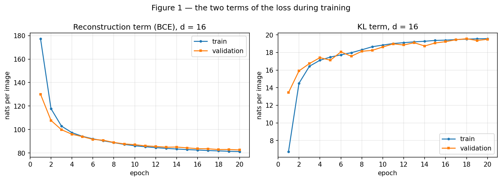
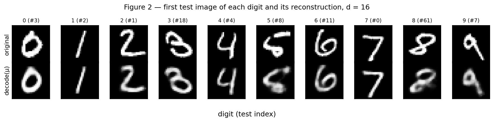
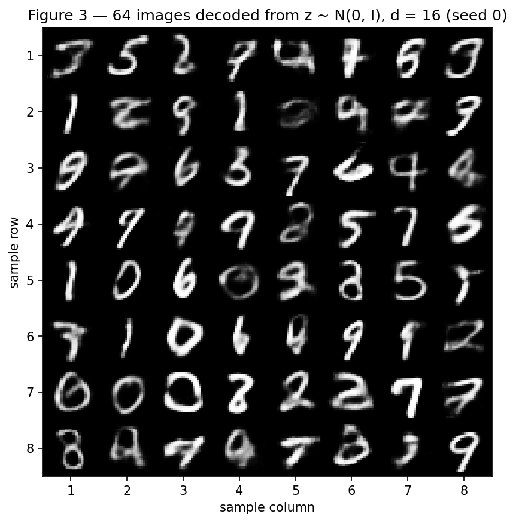
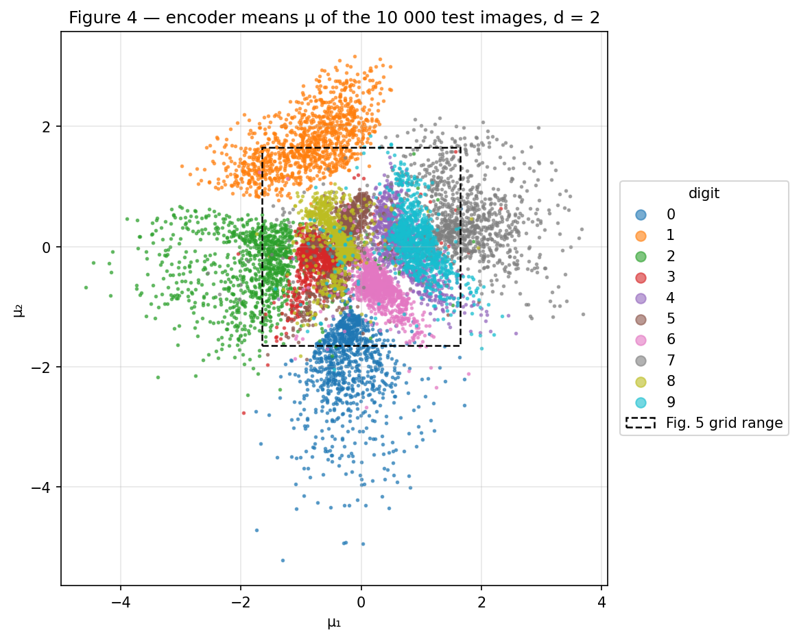
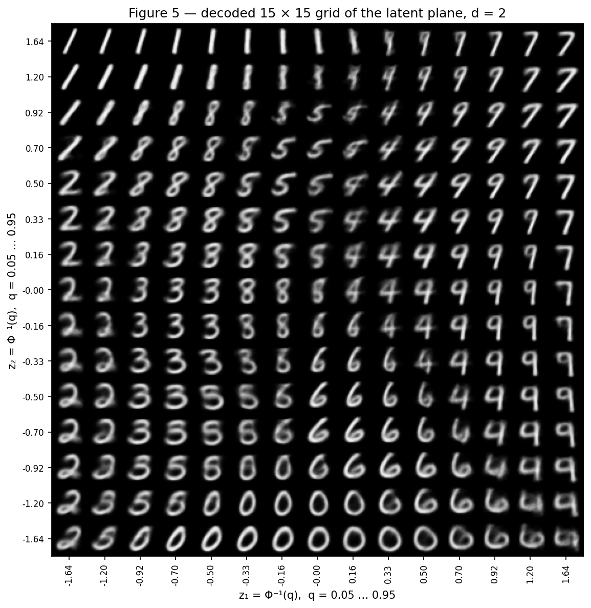
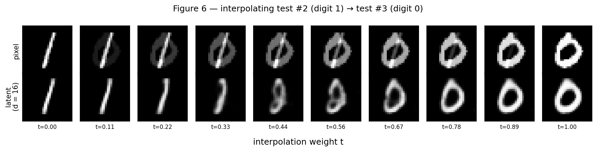

# VAE — The Tug of War Inside the Loss

**Approach.** Everything in this report is produced by a single script,
[`code/vae.py`](code/vae.py). Running it from the repository root

```shell
python docs/exercises/vae/code/vae.py
```

downloads MNIST into `data/` (git-ignored), trains the $d = 16$ and the $d = 2$ VAEs (about 27 s
each on a laptop CPU), and regenerates the six figures in `figures/` and every number quoted below
(`figures/results.json`). `torch.manual_seed(42)` is called right before each model is built,
the train/validation split uses its own `torch.Generator().manual_seed(42)`, and
`torch.use_deterministic_algorithms(True)` is on: two consecutive runs give identical numbers.

What is written by hand: the reparameterization $\mathbf{z} = \mu + \sigma \odot
\varepsilon$, the BCE reconstruction term summed over the 784 pixels, the closed-form KL,
and sampling from the prior. PyTorch provides the `Linear` layers, autograd and Adam; torchvision
only loads MNIST; `scipy.stats.norm.ppf` builds the grid of Figure 5; scikit-learn is used only for a
$k$-NN in the analysis of 2E. No VAE class from a library, no `torch.distributions`.

All loss values are in **nats per image**: summed over pixels (reconstruction) or latent dimensions
(KL), averaged over images. Validation and test numbers are computed with $\mathbf{z} \sim q(\mathbf{z}\mid\mathbf{x})$
(one sample per image, from a generator with a fixed seed), so their sum is a one-sample estimate
of the negative ELBO. The test set goes through each model exactly once, after training.

??? note "Setup (imports, constants, helpers)"

    ```python
    --8<-- "docs/exercises/vae/code/vae.py:setup"
    ```

## Exercise 1 — A VAE on MNIST

### A — Load and split the data

```python
--8<-- "docs/exercises/vae/code/vae.py:data"
```

- **Train**: 50 000 images, **validation**: 10 000 images — both from the official 60 000 training
  images, split with `random_split(..., [50_000, 10_000], generator=torch.Generator().manual_seed(42))`.
- **Test**: the official 10 000 test images. They are not used by the training loop, by the
  monitoring, or by any choice; only by the final numbers of each model and by the figures the
  statement asks to be drawn on test images (2, 4, 6).
- Pixels are in $[0, 1]$ (`ToTensor`) and flattened to 784-vectors. 91.3% of the training pixels
  are below 0.1 or above 0.9 — MNIST is almost binary, which is what justifies the Bernoulli
  likelihood below.

### B — Build the model

```python
--8<-- "docs/exercises/vae/code/vae.py:model"
```

**Architecture.** Encoder $784 \to 512 \to 256$ (ReLU after each layer); two linear heads
$256 \to d$ for $\mu$ and $\log\sigma^2$; decoder $d \to 256 \to 512 \to 784$
with ReLU on the hidden layers and a sigmoid at the output; $d = 16$.

**Reparameterization.** Sampling $\mathbf{z} \sim \mathcal{N}(\mu, \operatorname{diag}\sigma^2)$
directly is not differentiable with respect to $\mu, \sigma$. Writing
$\mathbf{z} = \mu + \sigma \odot \varepsilon$ with
$\varepsilon \sim \mathcal{N}(\mathbf{0}, \mathbf{I})$ moves the randomness into
$\varepsilon$, which does not depend on any parameter, so
$\partial\mathbf{z}/\partial\mu = 1$ and $\partial\mathbf{z}/\partial\sigma = \varepsilon$
and backprop goes through. The head predicts $\log\sigma^2$ (any real number) and
$\sigma = \exp(\tfrac12 \log\sigma^2)$, so $\sigma > 0$ without any constraint.

**Loss, per image.**

$$
\underbrace{-\sum_{j=1}^{784}\Big[x_j \log \hat x_j + (1 - x_j)\log(1 - \hat x_j)\Big]}_{\text{reconstruction} \;=\; -\log p(\mathbf{x}\mid\mathbf{z})}
\;+\; \beta\,\underbrace{\tfrac12 \sum_{i=1}^{d}\Big(\mu_i^2 + \sigma_i^2 - 1 - \log \sigma_i^2\Big)}_{\mathrm{KL}\left(q(\mathbf{z}\mid\mathbf{x})\,\|\,\mathcal{N}(\mathbf{0},\mathbf{I})\right)},
\qquad \beta = 1,
$$

averaged over the images of the batch. The reconstruction term uses
`F.binary_cross_entropy(..., reduction="sum")` divided by the batch size: with `reduction="mean"`
it would also be divided by 784, which is the same as training with $\beta \approx 784$. The KL is
the closed form for two Gaussians, written out term by term (no `kl_divergence`).

### C — Train

```python
--8<-- "docs/exercises/vae/code/vae.py:train"
```

Adam, learning rate $10^{-3}$, batch size 128, 20 epochs. At the end of every epoch both terms are
recorded separately: the **train** value is the average over all the batches of that epoch (so it
is measured while the weights move — at epoch 1 it includes the very first, untrained batches); the
**validation** value is computed on the whole validation set with the weights at the end of the
epoch. Training took 27.2 s.

```python
--8<-- "docs/exercises/vae/code/vae.py:test16"
```

**Test numbers ($d = 16$):**

| Term | Test (nats / image) |
|---|---|
| Reconstruction (BCE) | **81.94** |
| KL | **19.54** |
| Negative ELBO (sum) | **101.48** |



/// caption
**Figure 1** — Reconstruction term (left) and KL term (right) per epoch, train and validation, $d = 16$.
///

Validation KL: **13.44** nats at epoch 1 and **19.50** at epoch 20. Validation reconstruction:
130.09 → 82.57. Train and validation curves end close together (81.19 vs 82.57 for reconstruction,
19.57 vs 19.50 for KL): no sign of overfitting in 20 epochs. At epoch 1 the train curves are worse
than validation (higher reconstruction, lower KL) only because they average the whole first epoch,
including the untrained start.

### D — Reconstructions and samples

```python
--8<-- "docs/exercises/vae/code/vae.py:fig23"
```



/// caption
**Figure 2** — Top: the first test image of each digit (test index in parentheses). Bottom: its
reconstruction $\text{decode}(\mu)$ by the $d = 16$ model.
///



/// caption
**Figure 3** — 64 images decoded from $\mathbf{z} \sim \mathcal{N}(\mathbf{0}, \mathbf{I})$
(`torch.manual_seed(0)`), $d = 16$.
///

### E — Analysis

**1. Why does the optimizer choose to pay more KL?**

At initialization the encoder outputs $\mu \approx \mathbf{0}$ and $\log\sigma^2 \approx \mathbf{0}$
for every image, so $q(\mathbf{z}\mid\mathbf{x}) \approx \mathcal{N}(\mathbf{0}, \mathbf{I})$: the KL is
essentially zero (0.03 nats on validation before the first step) but $\mathbf{z}$ carries no
information about $\mathbf{x}$, and the reconstruction costs 544.7 nats. The KL is the *price of
information*: it measures how far, in nats, each image's posterior moves away from the prior —
how much $\mathbf{z}$ tells about which image it came from. The decoder can only reconstruct a
specific digit if $\mathbf{z}$ says which one, so every nat of KL the encoder spends buys a
reduction in reconstruction. As long as one more nat of KL saves more than one nat of
reconstruction, the total $L = \text{rec} + \text{KL}$ goes down, and gradient descent takes the
deal. Figure 1 shows the exchange rate: on train, from epoch 2 to epoch 20, the KL rises by
**5.1** nats (14.50 → 19.57) while the reconstruction falls by **36.6** (117.78 → 81.19); measured
from the untrained model, about 19.5 nats of KL bought about 460 nats of reconstruction. The KL
flattens near 19.5 when the next nat of information no longer pays for itself.

The trade is visible dimension by dimension: on the training set, **11 of the 16** latent
dimensions are used (variance of $\mu_i$ across images ≈ 0.86–1.10, posterior std
$\sigma_i \approx 0.09$–0.40), while the other **5** have $\mu_i \approx 0$ for every image and
$\sigma_i \approx 1$ — exactly the prior, zero KL, zero information. The optimizer pays KL only in the
dimensions where the information is worth more than it costs, and switches the rest off.

**2. Why do the samples (Figure 3) look worse than the reconstructions (Figure 2)?**

*(a) Where prior samples land.* The prior asks the **aggregate** of all posteriors to look like
$\mathcal{N}(\mathbf{0}, \mathbf{I})$, but with $\beta = 1$ the KL is only a soft penalty: each
training image occupies a small Gaussian blob ($\sigma_i \approx 0.1$–0.4 in the active dimensions)
and the union of 50 000 blobs in 11 active dimensions does not fill the whole prior — it leaves
holes and low-density regions between digit classes. A $\mathbf{z}$ drawn from the prior
can land there, where the decoder was (almost) never trained, and it decodes to something that is
not a digit, or a blend of two (row 2 column 5, row 3 column 8, row 6 column 8 in Figure 3). In
numbers: the median distance from a prior sample to the nearest training $\mu$ is
**2.58**, while for a test image's $\mu$ it is **1.08** — prior samples land, on
average, much farther from anything the decoder learned on than real encodings do. A
reconstruction never has this problem: $\mu$ of a real image is by construction in a
region the decoder trained on.

*(b) What the decoder outputs for a given $\mathbf{z}$.* The decoder does not output an image; it
outputs the **Bernoulli probabilities** $\hat x_j = p(x_j = 1\mid\mathbf{z})$, i.e. the mean
$\mathbb{E}[\mathbf{x}\mid\mathbf{z}]$. Many training images (different stroke widths, small shifts)
map to overlapping neighbourhoods of the latent space, and the BCE-optimal output for that
$\mathbf{z}$ is their pixel-wise average — so pixels where the strokes disagree come out grey, and
we display that mean instead of sampling binary pixels from it. This affects reconstructions too
(Figure 2: 14.6% of decoded pixels are grey, between 0.1 and 0.9, against 8.6% in the real test
images), but it is worse for prior samples (16.8%) because in the poorly-covered regions of (a)
the decoder's uncertainty, and so the averaging, is larger.

**3. Why decode $\mu$ rather than a sampled $\mathbf{z}$ in Figure 2?**

$\mu$ is the encoder's best guess for the code of that image — the centre of
$q(\mathbf{z}\mid\mathbf{x})$, its most probable point. A sampled $\mathbf{z} = \mu +
\sigma\odot\varepsilon$ adds noise that is useful during training (it forces
nearby codes to decode to similar images, which is what makes the latent space smooth), but at
display time it would only make the figure random: a different $\varepsilon$ gives a
slightly different reconstruction, and in the 5 inactive dimensions $\sigma \approx 1$, so a sample
would wander in directions that carry nothing. Decoding $\mu$ gives a deterministic,
reproducible picture of what the model has learned about that image.

## Exercise 2 — A Latent Space You Can See

### A — Train a 2-D VAE

```python
--8<-- "docs/exercises/vae/code/vae.py:train2"
```

Exactly the same function, data, seed, $\beta$, optimizer and 20-epoch budget; only $d = 2$.

| Model | Test reconstruction | Test KL | Negative ELBO |
|---|---|---|---|
| $d = 16$ (Exercise 1) | 81.94 | 19.54 | 101.48 |
| $d = 2$ | **133.60** | **6.80** | **140.40** |

The $d = 2$ model pays **12.7** fewer nats of KL but **51.7** more of reconstruction: its total is
38.9 nats worse. Two dimensions can only hold a few nats of information about each image.

### B — The encoded test set



/// caption
**Figure 4** — Encoder means $\mu$ of all 10 000 test images, $d = 2$, coloured by
digit. The dashed square is the region decoded in Figure 5 ($|z_i| \le \Phi^{-1}(0.95) = 1.645$).
///

### C — The decoded plane

```python
--8<-- "docs/exercises/vae/code/vae.py:fig5"
```

The grid points are $z = \Phi^{-1}(q)$ with $q \in \{0.05, 0.114, \dots, 0.95\}$ (15 values), i.e.
$z \in \{-1.645, -1.204, -0.921, \dots, 0, \dots, 1.204, 1.645\}$, in both coordinates.
**Why this spacing:** since $\Phi$ is the CDF of the prior, consecutive points
$\Phi^{-1}(q_k)$ and $\Phi^{-1}(q_{k+1})$ always enclose the same prior probability
$q_{k+1} - q_k$, so every cell of the grid holds the same prior mass — the grid is dense near the
origin, where most of the prior (and of the data) is, and sparse in the tails, instead of wasting
cells on regions the prior almost never samples.



/// caption
**Figure 5** — Decoder output on a 15 × 15 grid of the latent plane, $d = 2$. Columns:
$z_1$ increasing left to right; rows: $z_2$ increasing bottom to top (same orientation as Figure 4).
///

### D — Interpolation

```python
--8<-- "docs/exercises/vae/code/vae.py:fig6"
```

Endpoints: **test index 2** (a "1") and **test index 3** (a "0") — two digits as different in shape as
possible (a single stroke vs. a closed loop), which makes the two kinds of interpolation easy to
tell apart. The latent row uses the **$d = 16$ model from Exercise 1**.



/// caption
**Figure 6** — Top: pixel-space interpolation $(1 - t)\,\mathbf{x}_a + t\,\mathbf{x}_b$. Bottom:
latent-space interpolation, $\text{decode}\big((1 - t)\,\mu_a + t\,\mu_b\big)$
with the $d = 16$ model. $t$ goes from 0 to 1 in 10 steps.
///

### E — Analysis

**1. Which digits overlap in Figure 4, and what does the transition look like in Figure 5?**

The clearest overlap is **4 and 9**: in Figure 4 the purple (4) and cyan (9) clouds sit on top of each
other around $\mu \approx (0.7, 0)$ to $(0.9, 0.1)$ (class centroids $(0.73, 0.00)$ and $(0.88, 0.06)$).
A 15-nearest-neighbour classifier fit on the training $\mu$'s reaches 82.2% on the test
$\mu$'s, and its most frequent confusion is 4 ↔ 9 (**572** of the test errors), followed by
5 ↔ 8 (263), 3 ↔ 5 (154), 3 ↔ 8 (136) and 7 ↔ 9 (120). The 3, 5 and 8 clouds are the second
overlap: they share the centre of the plane (centroids $(-0.68, -0.21)$, $(-0.31, 0.02)$,
$(-0.41, 0.11)$).

In Figure 5 the 4 ↔ 9 transition is in the right half, columns $z_1 \approx 0.16$ to $0.92$, rows
$z_2 \approx -0.5$ to $0.7$: going from the "4"s to the "9"s, the open top of the 4 gradually closes —
the two upper strokes bend towards each other and merge into a loop — and the in-between cells are
a 4 with an almost-closed head, which is exactly the ambiguous handwriting that makes these classes
overlap. The 3/5/8 overlap is the centre-left of the grid ($z_1 \approx -0.9$ to $0$, $z_2 \approx 0$ to
$0.7$): an 8 whose upper-left part fades into a 5, and a 3 whose left side closes into an 8; the
in-between images are blurrier and fainter than the pure digits, because the decoder averages
the classes it cannot separate there.

**2. What do two numbers per image force the model to discard?**

With two numbers the code has room for little more than **which digit** and **one or two coarse
style factors**. Figure 5 is the evidence: across the whole plane the only variations are the class,
a slant (the 1s go from tilted to upright from left to right in the top rows) and a bit of width
(the 0s in the bottom row get rounder from left to right). Everything else that distinguishes one handwritten digit from
another — stroke thickness, the exact length and position of each stroke, small loops, gaps, serifs,
an unusual shape — has no coordinate to live in, so the decoder outputs a *prototypical* digit of
the class plus a slant, and every individual detail is paid for in reconstruction. That is the
51.7-nat gap. It is largest for digits with the most individual variation in shape and smallest for
the simplest: decoding $\mu$, the test reconstruction of a 2 goes from 92.2 ($d = 16$)
to 166.0 ($d = 2$), of an 8 from 96.9 to 161.9, of a 3 from 87.4 to 151.5, while a 1 — one straight
stroke, fully described by its slant — only goes from 35.9 to 52.2. The KL tells the same story:
the $d = 2$ model can only spend 6.8 nats of information per image, against 19.5 for $d = 16$.

**3. Pixel-space vs. latent-space interpolation (Figure 6).**

The **latent** row is the one that passes through digit-like images. It is one object that changes
shape: the "1" first bends into a curved stroke ($t = 0.22$–$0.33$), then the stroke opens into a
narrow loop ($t \approx 0.44$–$0.56$ — the least clean frames, a thin "0"/"8"-like shape) that widens
into the "0". The amount of ink also follows the shape, not a straight line: it stays near the
1's (39 → 50 pixels of ink) until $t = 0.33$ and only then grows to the 0's 145. The **pixel** row
never looks like a digit: every intermediate frame is the "1" and the "0" *superimposed*, each at
partial intensity — a faded loop with a vertical bar through it, the ink growing linearly from 39 to
145. Measured by the RMS distance to the nearest of the 50 000 training images, the pixel midpoint
($t = 0.56$) is 0.198 away, the latent one 0.168; the pixel row is farther from real digits at every
intermediate step.

The reason: the set of images of handwritten digits is a thin, curved surface in the 784-dimensional
pixel space. The average of two points on it is a point *off* it — superimposing two digits is
not a digit. The VAE's latent space is trained so that nearby codes decode to similar images and
(through the KL) codes are packed together around the origin, so the straight segment between
$\mu_a$ and $\mu_b$ stays mostly in regions the decoder learned, and every point
on it is mapped back *onto* the surface of digit-like images. It is not perfect: the middle of the
segment crosses the space between the "1" and "0" clusters, which is less populated (the same holes
as in 1E.2a), and those frames are the blurriest of the row.

## Results summary

| # | Quantity | Value |
|---|---|---|
| 1 | Ex. 1 — test reconstruction, KL and negative ELBO ($d = 16$) | 81.94 + 19.54 = **101.48** nats/image |
| 2 | Ex. 1 — validation KL at the first and last epoch | **13.44** (epoch 1) → **19.50** (epoch 20) nats/image |
| 3 | Ex. 2 — test reconstruction and KL ($d = 2$) | **133.60** and **6.80** nats/image (negative ELBO 140.40) |
| 4 | Ex. 2 — the two test indices interpolated | **2** (digit 1) and **3** (digit 0) |

All values are reproducible by running `python docs/exercises/vae/code/vae.py` (seeds fixed as
described above); they are also dumped to [`figures/results.json`](figures/results.json).
