# Project 1 — EDA: Hotel Booking Demand

**Question.** Can we tell, at booking time, whether a hotel booking will be **canceled**?
Target: `is_canceled` (binary classification). This EDA ends with a preprocessing pipeline ready
for the neural network of the next deliverable; no model is trained here.

**How to reproduce.** Everything below comes from two files in [`code/`](code/):

- [`code/pipeline.py`](code/pipeline.py) — importable module: loading, row cleaning, the split and the
  `Pipeline` + `ColumnTransformer` (section 4.C);
- [`code/eda.py`](code/eda.py) — every figure in `figures/`, every number quoted
  ([`figures/results.json`](figures/results.json)) and the long tables (`figures/tables.txt`, embedded
  below as snippets, so the tables in this page are the program output, not hand-copied).

```shell
pip install -r requirements.txt
python docs/projects/eda/code/eda.py     # ~1 min; runs from a clean clone (the CSV is in data/)
```

`random_state = 42` everywhere (split, samples, t-SNE, UMAP). Two consecutive runs produce an
identical `results.json`.

??? note "Setup (imports, helpers) and pipeline constants"

    ```python
    --8<-- "docs/projects/eda/code/eda.py:setup"
    ```

    ```python
    --8<-- "docs/projects/eda/code/pipeline.py:constants"
    ```

## 0. Proposal

Three datasets were checked against the requirements (public, tabular, ≥ 1 000 rows, ≥ 5 features with
both numerical and categorical ones, target in the file, not a classic): **Hotel Booking Demand**
(119 390 × 32, first choice), UCI *Bank Marketing* (41 188 × 21) and UCI *Online Shoppers Purchasing
Intention* (12 330 × 18). This report uses the first.

## 1. Initial inspection

### A — Data dictionary

**Source.** Antonio, Almeida & Nunes, *Hotel booking demand datasets*, Data in Brief 22 (2019) 41–49
([doi:10.1016/j.dib.2018.11.126](https://doi.org/10.1016/j.dib.2018.11.126)); public copy on
[Kaggle](https://www.kaggle.com/datasets/jessemostipak/hotel-booking-demand) and in
[TidyTuesday 2020-02-11](https://github.com/rfordatascience/tidytuesday/tree/master/data/2020/2020-02-11),
from which the CSV in [`data/hotel_bookings.csv`](data/hotel_bookings.csv) was downloaded.
The data come from the property-management systems of two hotels in Portugal: a resort in the
Algarve (*Resort Hotel*) and a hotel in Lisbon (*City Hotel*).

**What a row is.** One **booking**, with arrival date between **2015-07-01 and 2017-08-31** —
119 390 rows × 32 columns (target + 31 features: **16 numerical, 15 categorical**, counting the
binary flag and the two IDs `agent`/`company` as categorical). Customer identity is anonymised;
there is **no booking ID**.

| Column | Meaning | Type | Unit / values | Distinct |
|---|---|---|---|---|
| `is_canceled` | **target**: the booking was canceled (1) or not (0) | binary | 0 / 1 | 2 |
| `hotel` | which hotel | categorical | Resort Hotel, City Hotel | 2 |
| `lead_time` | days between entering the booking and the arrival date | numerical (int) | days | 479 |
| `arrival_date_year` | year of arrival | numerical (int) | 2015–2017 | 3 |
| `arrival_date_month` | month of arrival | categorical (ordinal) | January … December | 12 |
| `arrival_date_week_number` | ISO week of arrival | numerical (int) | 1–53 | 53 |
| `arrival_date_day_of_month` | day of arrival | numerical (int) | 1–31 | 31 |
| `stays_in_weekend_nights` | Saturday/Sunday nights booked | numerical (count) | nights | 17 |
| `stays_in_week_nights` | Monday–Friday nights booked | numerical (count) | nights | 35 |
| `adults` | number of adults | numerical (count) | persons | 14 |
| `children` | number of children | numerical (count) | persons | 5 |
| `babies` | number of babies | numerical (count) | persons | 5 |
| `meal` | meal plan: BB bed & breakfast, HB half board, FB full board, SC / Undefined no meal | categorical | 5 codes | 5 |
| `country` | country of origin | categorical | ISO 3166-1 alpha-3 | 177 |
| `market_segment` | market segment (TA travel agent, TO tour operator) | categorical | 8 labels | 8 |
| `distribution_channel` | booking distribution channel | categorical | 5 labels | 5 |
| `is_repeated_guest` | the guest had stayed before | binary | 0 / 1 | 2 |
| `previous_cancellations` | earlier bookings of this customer that were canceled | numerical (count) | bookings | 15 |
| `previous_bookings_not_canceled` | earlier bookings of this customer that were not canceled | numerical (count) | bookings | 73 |
| `reserved_room_type` | room type booked (anonymised code) | categorical | A–L | 10 |
| `assigned_room_type` | room type actually assigned | categorical | A–L, P | 12 |
| `booking_changes` | changes made to the booking until check-in or cancellation | numerical (count) | changes | 21 |
| `deposit_type` | No Deposit / Non Refund (full stay paid) / Refundable | categorical | 3 labels | 3 |
| `agent` | ID of the travel agency that made the booking | categorical (ID) | anonymised ID | 333 |
| `company` | ID of the company that made / pays the booking | categorical (ID) | anonymised ID | 352 |
| `days_in_waiting_list` | days in the waiting list before confirmation | numerical (count) | days | 128 |
| `customer_type` | Transient, Transient-Party, Contract, Group | categorical | 4 labels | 4 |
| `adr` | average daily rate = lodging transactions ÷ nights | numerical (float) | € per night | 8 879 |
| `required_car_parking_spaces` | car parking spaces required | numerical (count) | spaces | 5 |
| `total_of_special_requests` | special requests (twin bed, high floor, …) | numerical (count) | requests | 6 |
| `reservation_status` | last status: Canceled, Check-Out, No-Show | categorical | 3 labels | 3 |
| `reservation_status_date` | date of the last status | categorical (date) | YYYY-MM-DD | 926 |

/// caption
**Table 1** — Data dictionary (distinct values counted on the raw file).
///

### B — Quality

```python
--8<-- "docs/projects/eda/code/eda.py:quality"
```

**Missing values** (raw file, 119 390 rows):

--8<-- "docs/projects/eda/figures/tables.txt:t2"

/// caption
**Table 2** — Missing values per column (count and %), raw file; the other 28 columns have none.
///

In the source, `agent` and `company` are the string `NULL` when the booking was made **without** a
travel agency / company: their "missing" values are information, not errors. `company` is 94.31%
missing.

**Duplicates.** **31 994** rows (26.80%) are exact copies of an earlier row. Without a booking ID
they cannot be told apart from the original, and if kept, the same row would land in train *and* in
test. They are not random: **63.1%** of the removed copies are cancellations (vs 37.0% in the file)
and **42.4%** have `deposit_type = Non Refund` — they are mostly blocks of identical non-refundable
bookings made by agencies for groups (in the raw file, 63% of the `Non Refund` bookings are in the
`Groups` segment, 34% `Offline TA/TO`, 86% made through an agency; `Non Refund` drops from 14 587 rows
to 1 038 after de-duplication). **Decision:** drop exact duplicates (keep the first), and report the consequence: the
cancellation rate falls from 37.0% to 27.5% (Figure 1).

**Impossible or inconsistent values:**

| Check | Rows | Decision |
|---|---|---|
| 0 guests (adults + children + babies = 0) | 180 | invalid booking → row dropped (166 left after de-duplication) |
| adults = 0 but children > 0 | 223 | possible (minors booked by a parent) → kept |
| `adr` < 0 (−6.38) | 1 | impossible price → clipped to 0 (section 4.A) |
| `adr` > 1 000 (5 400) | 1 | 16× the 99.9th percentile → clipped (section 4.A) |
| `adr` = 0 | 1 959 | free or package stays (35% of them are `market_segment = Complementary`) → kept |
| 0 nights | 715 | day-use bookings → kept |
| `meal = Undefined` | 1 169 | same as SC per the source → kept as its own category (it cancels less: 15% vs 36%, Figure 8) |

No column is constant.

**Columns that leak the target.** A feature leaks if its value is only known *after* the outcome:

| Column | Evidence | Decision |
|---|---|---|
| `reservation_status` | Canceled (43 017) and No-Show (1 207) ⇔ `is_canceled = 1`; Check-Out (75 166) ⇔ 0 — it **is** the target | drop |
| `reservation_status_date` | earlier than the arrival date in 42 137 rows, **100%** of them canceled (2.7% otherwise) — it is the cancellation date | drop |
| `assigned_room_type` | the room is assigned at check-in: when it differs from the booked one (14 917 rows) only **5.4%** were canceled vs 41.6% when equal — a canceled booking never gets a different room | drop |
| `required_car_parking_spaces` | **0 of 7 416** bookings with a parking space were canceled (39.5% otherwise). An exact 0% is not behaviour, it is a field filled at arrival — found while reading the UMAP islands (section 4.B) | drop |
| `booking_changes` | counted "until check-in **or cancellation**", so partly post-booking — but not deterministic (15.5% canceled when > 0) | keep, flagged as a risk (section 5) |

Also dropped: `company` (94% missing, replaced by the flag `has_company`), `arrival_date_year` (only 3
values; a deployed model sees only future years) and `arrival_date_week_number` (redundant with the
month, ρ = 0.995 — section 3.A). The IDs `agent` / `company` are categories, never numbers.

### C — Target

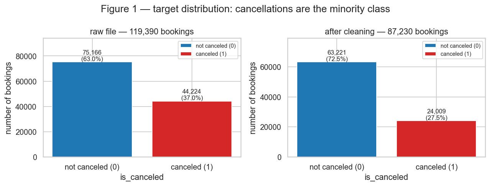

/// caption
**Figure 1** — Class frequencies of `is_canceled` in the raw file and after cleaning.
///

After cleaning: **63 221 not canceled (72.5%) and 24 009 canceled (27.5%)**, a ratio of 2.6 : 1 —
moderate imbalance. A model that always says "not canceled" is already 72.5% accurate, so accuracy
alone is a poor metric; the next deliverable should report F1 / PR-AUC of the canceled class and use
class weights or a tuned threshold. **Conclusion:** cancellations are the minority class, and the
de-duplication changed the base rate, so numbers here are not comparable to studies using the raw file.

### D — Train / test split

```python
--8<-- "docs/projects/eda/code/pipeline.py:load"
```

```python
--8<-- "docs/projects/eda/code/eda.py:split"
```

- Only two row rules come before the split, and neither uses a statistic of the data: drop exact
  duplicates and drop 0-guest bookings. **No other decision has been made yet.**
- Split **80 / 20, stratified by the target, `random_state = 42`**: **69 784 train / 17 446 test**,
  27.52% canceled in both.
- **Why stratified and not temporal:** the cancellation rate is stable over the years (37.0%, 35.9%,
  38.7% for 2015, 2016, 2017 in the raw file), but it is strongly seasonal (14% to 34% by month and hotel,
  Figure 9). The data cover only 26 months, so a temporal split (last 20% of arrivals ≈ May–August 2017)
  would test on summer only, mixing "can the model predict cancellations" with "does it transfer to
  another season". The year is dropped from the features so the model cannot lean on it.
- **From here on, every statistic is computed on the training set only** — the test set is not
  looked at again until the pipeline is applied to it in 4.C.

## 2. Univariate analysis

### A — Numerical

--8<-- "docs/projects/eda/figures/tables.txt:t3"

/// caption
**Table 3** — The 16 numerical features on the training set (69 784 rows).
///

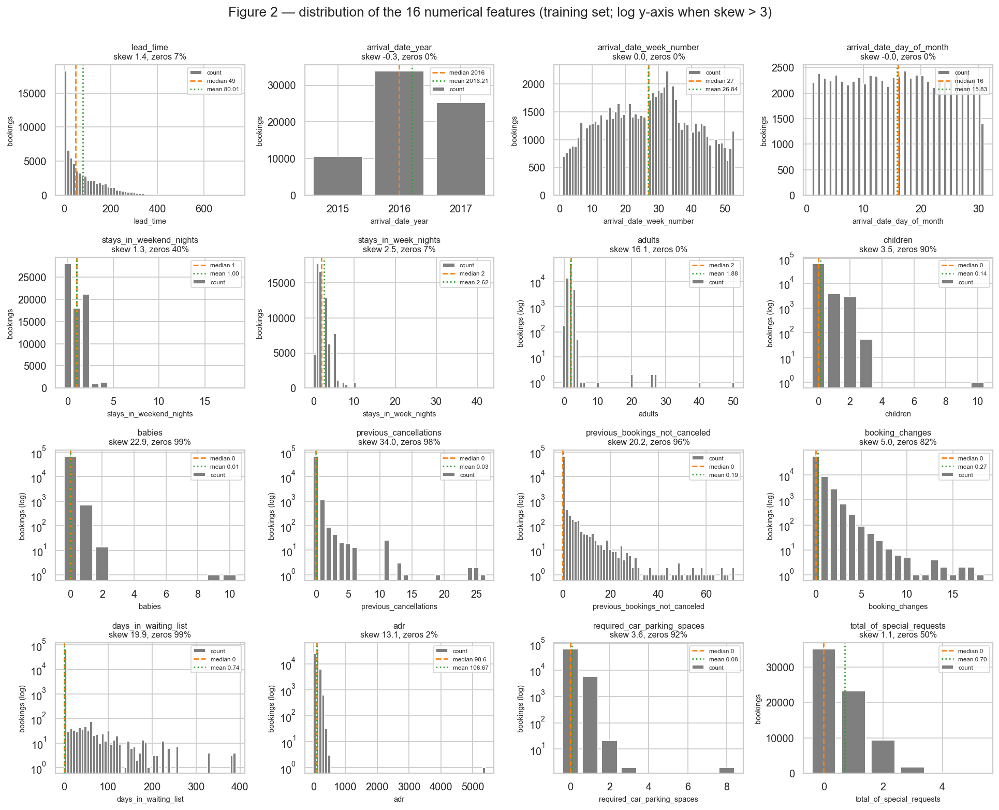

/// caption
**Figure 2** — Distribution of every numerical feature (training set). Log y-axis when skewness > 3.
///

Reading Figure 2 / Table 3, three shapes appear:

- **Right-skewed continuous:** `lead_time` (median 49, mean 80, max 737 days, skew 1.43) — mode near 0
  (last-minute bookings) and a long tail of bookings made a year or more ahead.
  `adr` is bell-shaped around a median of 98.6 € (Q1 72.3, Q3 134.1), but with one 5 400 € value
  and one negative price (−6.38): its skewness of 13.1 comes from **one** row.
- **Zero-inflated counts:** `children`, `babies`, `previous_cancellations`,
  `previous_bookings_not_canceled`, `booking_changes`, `days_in_waiting_list`,
  `required_car_parking_spaces` are 0 in 82% to 99% of the bookings, with rare and far non-zeros
  (up to 26 previous cancellations, 72 previous bookings, 391 days in the waiting list). Their mean
  and median disagree (median 0) and the skewness is 3.5 to 34.
- **Bounded / near-uniform:** `arrival_date_day_of_month` (uniform, skew 0.00), `arrival_date_week_number`
  (summer peak around weeks 27–35), `adults` (2 in most bookings, but up to 50: a few group bookings),
  `stays_in_weekend_nights` (modes 0, 1, 2).

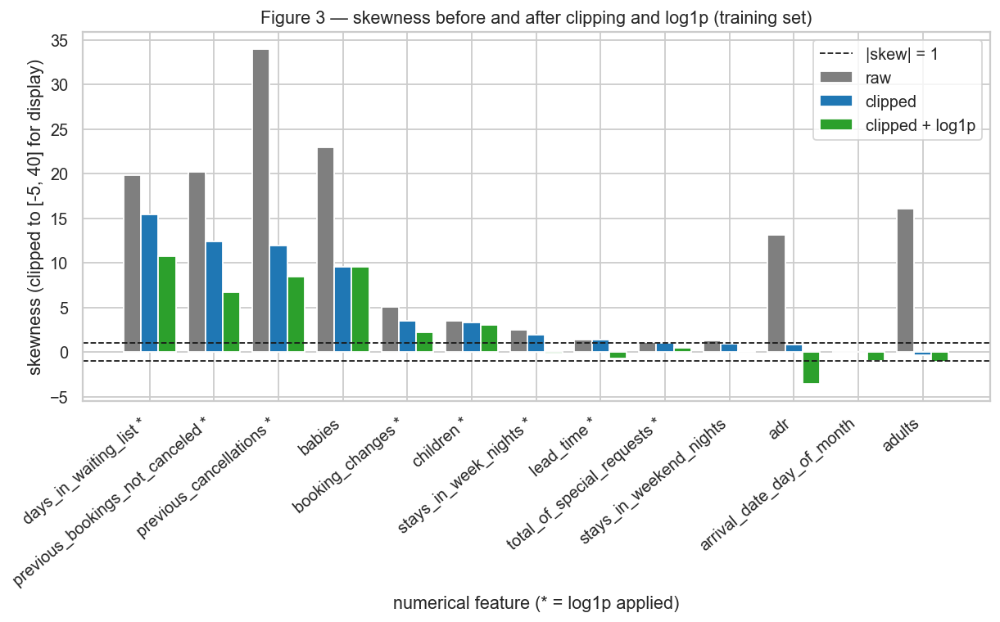

/// caption
**Figure 3** — Skewness of each model feature: raw, after clipping at the training 99.9th percentile,
and after clipping + `log1p` (training set). `*` = `log1p` applied in the pipeline.
///

**Conclusion of Figure 3:** clipping alone fixes the features whose skewness came from a handful of
rows (`adr` 13.1 → 0.84, `adults` 16.1 → −0.34), while for long-tailed counts the `log1p` is what
helps (`lead_time` 1.38 → −0.72, `stays_in_week_nights` 1.98 → −0.16). For zero-inflated
features nothing makes them symmetric (`babies` 9.6 → 9.6): the mass at 0 is the shape.
Table 4 (section 4.A) turns this into the rule used by the pipeline.

### B — Categorical

--8<-- "docs/projects/eda/figures/tables.txt:t5"

/// caption
**Table 5** — Cardinality, dominant category, missing share and rare categories (< 50 training
bookings) of every categorical feature (training set).
///

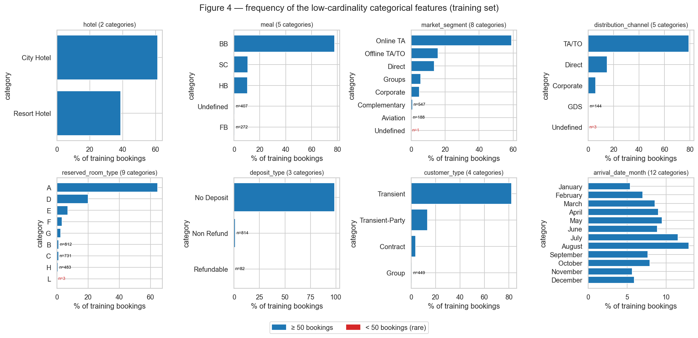

/// caption
**Figure 4** — Frequencies of the eight low-cardinality categorical features (training set); bars too
small to see are annotated with their count, in red when < 50.
///

**Conclusion of Figure 4:** every low-cardinality feature is dominated by one value — `deposit_type`
No Deposit 98.7%, `distribution_channel` TA/TO 79.1%, `meal` BB 77.9%, `customer_type` Transient
82.4%, `reserved_room_type` A 64.6%, `market_segment` Online TA 59.1%. **Rare categories:**
`market_segment = Undefined` (1 booking), `distribution_channel = Undefined` (3), `reserved_room_type = L`
(3) — too few to learn anything from; `deposit_type = Refundable` (82) and `customer_type = Group` (449)
are small but above the threshold. Arrivals are seasonal: August 12.9%, January 5.4%.

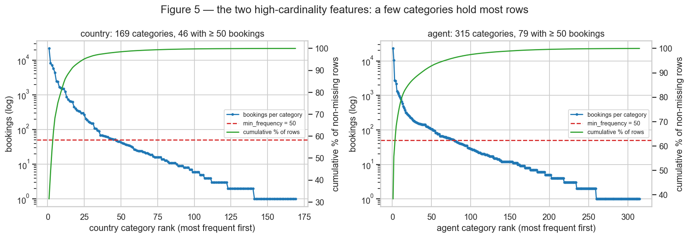

/// caption
**Figure 5** — Rank–frequency of the two high-cardinality features (log scale) and the cumulative share
of rows they cover (training set).
///

**Conclusion of Figure 5:** `country` (169 values) and `agent` (315 values) are **high-cardinality** with
a long tail: the top 5 countries hold 68.3% of the rows (Portugal alone 31.3%) and the top 5 agents
68.1% (agent 9 alone 33.0%), while 123 countries and 236 agents have fewer than 50 bookings and
together cover only 1.8% and 3.3% of the rows. Keeping the 46 countries / 79 agents with ≥ 50 bookings
covers 98.2% / 96.2% of the non-missing rows — this is the `min_frequency = 50` used in 4.A.

## 3. Bivariate and multivariate analysis

### A — Numerical × numerical

**Spearman, not Pearson.** Most numerical features are skewed, zero-inflated or ordinal counts
(Table 3), and a single extreme value (`adr` = 5 400, `adults` = 50) can dominate a Pearson
coefficient. Spearman uses ranks, so it measures any monotone relation and is robust to those tails.
The difference is visible: `previous_bookings_not_canceled` × `is_repeated_guest` has Pearson 0.443 but
Spearman 0.805 (Table 6). For this analysis the month is also converted to its number (1–12).

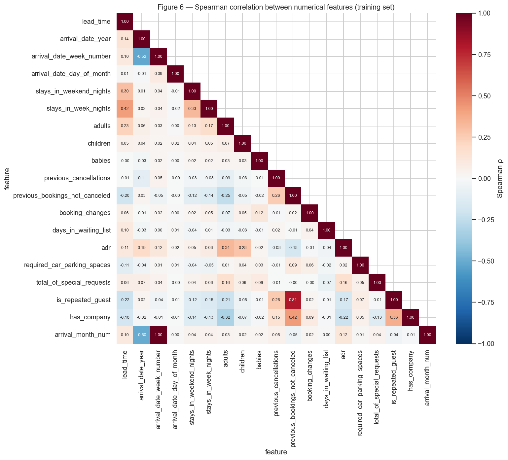

/// caption
**Figure 6** — Spearman correlation between the numerical features (training set).
///

--8<-- "docs/projects/eda/figures/tables.txt:t6"

/// caption
**Table 6** — The 10 most correlated pairs (training set), Spearman and Pearson.
///

**Conclusion of Figure 6:** almost every pair is weakly correlated (|ρ| < 0.35), so the features carry
mostly distinct information. The exceptions: `arrival_date_week_number` × month (ρ = 0.995, the same
information twice → **redundant, week number dropped**); `previous_bookings_not_canceled` ×
`is_repeated_guest` (ρ = 0.805, strongly related but one is a count and the other a flag → both kept);
and `arrival_date_year` × week/month (ρ ≈ −0.5), an artefact of the coverage (2015 starts in July,
2017 ends in August) — one more reason to drop the year.

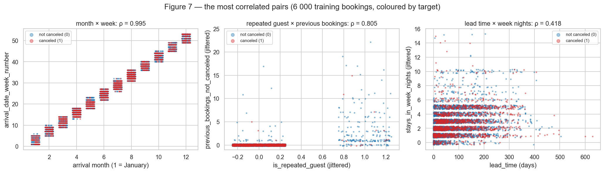

/// caption
**Figure 7** — The most correlated pairs on 6 000 training bookings, coloured by the target (jitter on
discrete axes).
///

**Conclusion of Figure 7:** (left) week number is a deterministic function of the month — redundant;
(middle) non-repeated guests have almost always 0 previous bookings, and repeated guests are almost
never canceled (few red points at `is_repeated_guest = 1`); (right) longer stays are booked further
ahead (ρ = 0.418), and canceled bookings are spread over the whole range, concentrated at larger lead
times — neither feature separates the classes on its own.

### B — Categorical × target

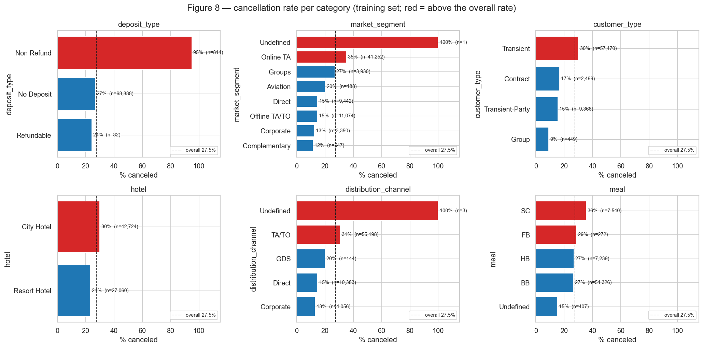

/// caption
**Figure 8** — Cancellation rate per category with the number of bookings (training set); dashed
line = overall 27.5%.
///

**Conclusion of Figure 8:** `deposit_type` is the strongest single categorical signal — **95.0%** of
`Non Refund` bookings are canceled (814 bookings) against 26.7% for No Deposit. It is counter-intuitive
(paying in advance should prevent cancellations) and is the group-agency pattern seen in the duplicates.
Next, the booking channel: `Online TA` 35.3% vs `Direct` 14.9% and `Corporate` 12.5%;
`TA/TO` channel 31.0% vs Direct 14.9%; `Transient` customers 30.1% vs `Group` 9.1%; City Hotel 30.1% vs
Resort 23.5%. `meal` matters little (BB 26.6%, HB 26.8%) except SC (35.6%). The 100% bars are single
bookings (`Undefined`, n = 1 and n = 3) — noise, merged into "infrequent" by the pipeline.

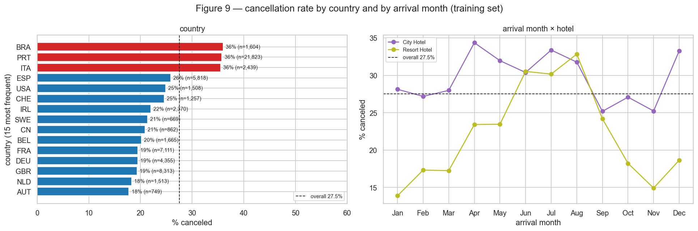

/// caption
**Figure 9** — Cancellation rate for the 15 most frequent countries, and by arrival month for each hotel
(training set).
///

**Conclusion of Figure 9:** domestic bookings cancel much more — Portugal **35.8%** (21 823 bookings) vs
19% for the UK, France and Germany — so `country` is informative and worth encoding despite its
cardinality. The month effect depends on the hotel: the Resort goes from **13.9%** in January to
**32.8%** in August, while the City Hotel stays between 25.2% and 34.4% all year. Hotel and month
interact, so both must be given to the network.

### C — Numerical × categorical

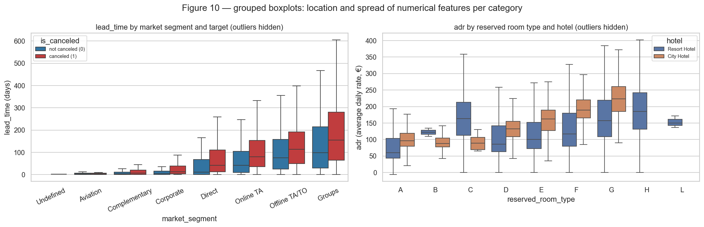

/// caption
**Figure 10** — `lead_time` by market segment split by target, and `adr` by reserved room type split by
hotel (training set, outliers hidden).
///

**Conclusion of Figure 10 (left):** the groups differ in **both location and spread**. Across segments,
the median lead time goes from 3 days (Aviation) to 98–155 days (Groups). Within *every* segment,
canceled bookings were made earlier and are more spread out: Online TA median 41 → 80 days (IQR 95 →
119), Direct 11 → 41 (IQR 66 → 99), Groups 98 → 155 (IQR 185 → 216); overall 38 vs 80 days. Long lead
time is a cancellation signal that holds inside each segment, not a segment effect.
**(right):** price grows with the room type in both hotels (location), but the Resort's prices are
much more spread for the same room (room A: City median 95.7 €, IQR 39.2; Resort median 60.0 €,
IQR 60.2) — the spread is explained by Figure 11.

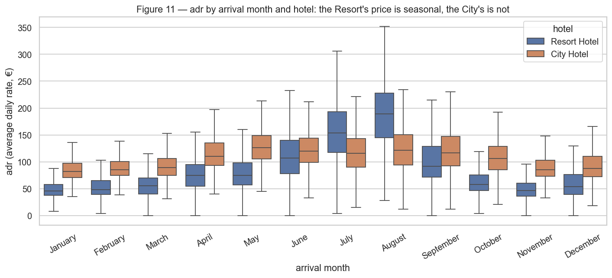

/// caption
**Figure 11** — `adr` by arrival month and hotel (training set, outliers hidden).
///

**Conclusion of Figure 11:** the Resort's price is **seasonal in location and spread** — median 45.8 € in
January vs 189.0 € in August, IQR 20.0 → 82.8 — while the City Hotel's median only moves between 81.6 €
and 126.0 €, with similar spread all year. `adr` therefore means different things in each hotel and
month (a 150 € night is cheap for the Resort in August and expensive in January), another hotel × month
interaction for the network.

## 4. Preprocessing

### A — Strategies

Each choice points to the finding that motivates it; every statistic (median, quantile, mean, standard
deviation, list of categories) is learned with `fit` on the **training set** only.

**Missing values** (training set: `children` 3, `country` 364, `agent` 9 733 rows; Table 2).

- `children` → **median** (0): 3 rows (< 0.01%), and 90% of the bookings have 0 children (Table 3).
- `country` and `agent` → **constant category `"missing"`**: for `agent`, missing means "booked without a
  travel agency" (14% of the rows, Table 5), which is information; for `country` (0.5%) it keeps the row
  without inventing a country.
- `company` → **dropped** and replaced by the flag `has_company` (94.3% missing, section 1.B).

**Outliers** — **clip each numerical feature to [0, 99.9th percentile of the training set]**
(`UpperClipper`), then `log1p` where the rule below says so. Motivated by Table 3: the maxima are
far from the bulk (`adr` 5 400 € vs Q3 134 €, `adults` 50 vs Q3 2, `days_in_waiting_list` 391 vs
99% zeros), and one negative `adr`. Clipping instead of dropping rows, because a deployed model must
also score unusual bookings, and because without it the 5 400 € booking would sit about **95 standard
deviations** from the mean after scaling — a single input able to saturate the network's activations.
**Rows affected: 599 training bookings (0.86%)** have at least one clipped value.

```python
--8<-- "docs/projects/eda/code/eda.py:skew_rule"
```

--8<-- "docs/projects/eda/figures/tables.txt:t4"

/// caption
**Table 4** — Rule for `log1p` (training set): apply it when the skewness after clipping is > 1 **and**
the log reduces it. 8 features qualify (Figure 3). `adr` does not: its 1.9% zeros would become
the long tail (−3.59). The script asserts that `pipeline.NUM_LOG` follows this rule.
///

**Categorical encoding** — **one-hot** (`OneHotEncoder`), because no categorical feature has a usable
order for a network (room codes are anonymised; months are cyclic, and a 1–12 number would put December
far from January). Two findings shape the encoder:

- high cardinality and rare categories (Figure 5, Table 5) → `min_frequency = 50`: categories with fewer
  than 50 training bookings are merged into one `infrequent` column per feature. `country` becomes 48
  columns instead of 170 and `agent` 81 instead of 316, keeping 98.2% / 96.2% of their rows in their
  own column;
- **a category that appears only in the test set** → `handle_unknown = "infrequent_if_exist"` sends it to
  that same `infrequent` column instead of failing. This happens: **9 test rows** have a country and
  **19 test rows** an agent never seen in training (e.g. countries ASM, BDI, CYM).

**Scaling** — **`StandardScaler`** on the numerical features (after clip/log), because their ranges go
from 0–4 (`total_of_special_requests`) and 0–3 (`adults`, clipped) to 0–484 (`lead_time`, clipped) and
0–337 € (`adr`, clipped) (Table 3/Table 4). For a network trained by gradient descent, inputs on such
different scales give some weights gradients orders of magnitude larger than others; standardised
inputs (mean 0, std 1) also keep tanh/sigmoid units out of saturation. The 0/1 flags and one-hot columns
are left as they are (already in [0, 1]). After the fit, the largest |mean| of a scaled column is
0.000 on train and 0.013 on test — the test set is transformed with the training statistics, as it should.

### B — Dimensionality reduction

All projections use the **192 preprocessed training columns** (output of 4.C), coloured by the target.
PCA is fitted on the whole training set; t-SNE and UMAP, which are slow and quadratic in memory, on a
**stratified sample of 5 000 training bookings** (27.5% canceled, as the full set).

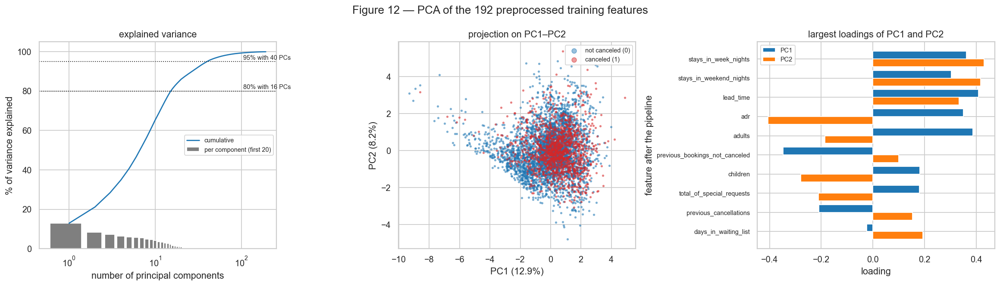

/// caption
**Figure 12** — PCA: cumulative explained variance (log x-axis), the sample projected on PC1–PC2, and the
largest loadings of PC1 and PC2.
///

**PCA.** PC1 explains **12.9%** and PC2 **8.2%** — **21.2% together**; 16 components are needed for 80%
and 40 for 95% of the variance. The variance is spread over many directions: the 192 columns are mostly
independent one-hot indicators. Reading the loadings:

- **PC1 — "size of the booking" vs "loyal customer":** positive on `lead_time` (0.41), `adults` (0.39),
  `stays_in_week_nights` (0.36), `adr` (0.35) and `stays_in_weekend_nights` (0.30); negative on
  `previous_bookings_not_canceled` (−0.35) and `previous_cancellations` (−0.21). High PC1 = a first-time
  customer booking a long, expensive stay for more people, well in advance.
- **PC2 — "long cheap stay" vs "short expensive family stay":** positive on the two stay lengths
  (0.43, 0.42) and `lead_time` (0.33), negative on `adr` (−0.41), `children` (−0.28) and
  `total_of_special_requests` (−0.21).

Both components are made of the 13 standardised numerical columns: a one-hot column has variance
p(1−p) ≤ 0.25, against 1 for a standardised feature, so PCA on this mixed matrix is dominated by the
numerical part. In the PC1–PC2 plane the classes overlap almost completely.

```python
--8<-- "docs/projects/eda/code/eda.py:manifold"
```

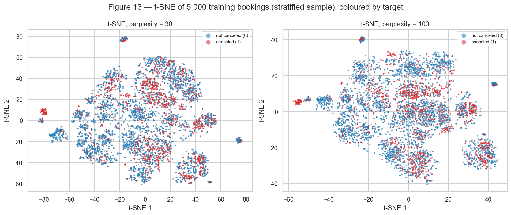

/// caption
**Figure 13** — t-SNE of the 5 000-booking sample, perplexity 30 and 100.
///

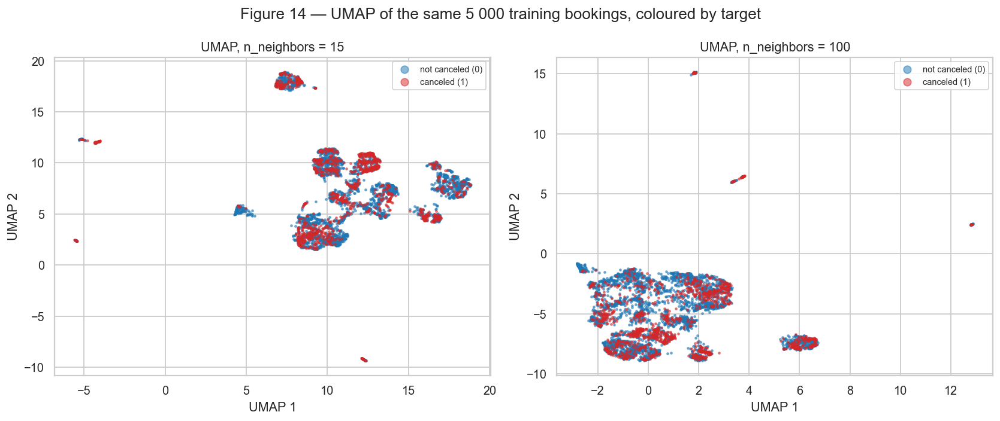

/// caption
**Figure 14** — UMAP of the same sample, `n_neighbors` 15 and 100.
///

**What the islands are.** To read the nonlinear maps instead of guessing, DBSCAN was run on the 2-D UMAP
(`n_neighbors = 15`) map and each group described by its cancellation rate and the features shared by
its members:

| Group (UMAP-15) | Bookings | % canceled | What defines it |
|---|---|---|---|
| main mass | 3 303 | 28.2 | City Hotel / Online TA, no previous history, no children |
| Direct bookings | 657 | 12.6 | `market_segment = Direct` (77%) |
| families | 417 | 34.8 | **`children > 0` (100%)** |
| City / Online TA | 267 | 40.8 | City Hotel (97%), Online TA (88%) |
| loyal customers | 134 | 3.7 | **`is_repeated_guest = 1` (81%)**, `has_company` (63%) |
| past cancellers | 87 | **70.1** | **`previous_cancellations > 0` (100%)** |
| waiting list | 53 | 34.0 | **`days_in_waiting_list > 0` (100%)** |
| babies | 49 | 14.3 | **`babies > 0` (100%)** |

/// caption
**Table 7** — Groups found by DBSCAN (`eps = 0.6`, `min_samples = 20`) on the UMAP map with `n_neighbors = 15`; 33 points are left as noise.
///

(Full table, with every descriptor, in `figures/tables.txt`, section t7.) The islands are the rare
non-zero values of zero-inflated features: after `log1p` + standardisation, a single non-zero value puts
a booking several standard deviations away from the 95–99% of zeros, so it forms its own neighbourhood.
The first version of this analysis had one more island — **409 bookings, 0% canceled**, all with
`required_car_parking_spaces > 0` — which is how the parking leak of section 1.B was found.

**Comparison.**

- **What the nonlinear maps reveal that PCA does not:** sub-populations with very different cancellation
  rates (past cancellers 70%, loyal customers 4%, Direct 13%) that PCA mixes in one cloud, because they
  differ by binary/count indicators that carry little variance. A 15-nearest-neighbour classifier on
  each 2-D map (5-fold CV on the sample) measures how much of the target the map keeps: **PCA 70.5%**
  (below the 72.5% of always predicting "not canceled"), **t-SNE 76.0% / 76.5%** (perplexity 30 / 100),
  **UMAP 76.2% / 75.0%** (`n_neighbors` 15 / 100), against **78.7%** on the full 192 columns.
- **Effect of the parameters:** small perplexity / `n_neighbors` fragment the data into many local islands;
  perplexity 100 and `n_neighbors` 100 give fewer, bigger groups and a more global layout, at a slightly
  lower separation for UMAP.
- **Limits:** the sizes of the islands and the distances between them have no direct meaning in t-SNE
  or UMAP (an island's area does not say how many bookings or how different they are), so the reading
  above only uses *which* points are together. No 2-D map separates the classes: even the best keeps
  canceled and non-canceled bookings mixed inside each island — the decision needs many features at once,
  which is the job of the network.

### C — Pipeline

```python
--8<-- "docs/projects/eda/code/pipeline.py:pipeline"
```

```python
--8<-- "docs/projects/eda/code/eda.py:fit"
```

The module is importable from any script (`sys.path.insert(0, "docs/projects/eda/code")`,
then `from pipeline import load_clean_split, build_preprocessor`); `fit` is called on `X_train` only,
and `X_test` only goes through `transform`.

- **Input:** 25 raw features (13 numerical, 2 binary flags, 10 categorical) after dropping the columns of
  section 1.B.
- **No `NaN` remains:** 0 in the transformed training matrix and 0 in the transformed test matrix.
- **Final shape:** **train (69 784, 192)**, **test (17 446, 192)** = 8 numerical with `log1p` + 5 numerical
  + 2 flags + 177 one-hot columns (hotel 2, month 12, meal 5, country 48, market_segment 8,
  distribution_channel 5, reserved_room_type 9, deposit_type 3, customer_type 4, agent 81).
- **Feature names** (`get_feature_names_out`, prefix removed):

--8<-- "docs/projects/eda/figures/tables.txt:t8"

/// caption
**Table 8** — The 192 output columns of the pipeline, by block.
///

## 5. Synthesis

**Main findings** (for whoever builds the model):

1. **Four columns leak the target** and are removed: `reservation_status`, `reservation_status_date`,
   `assigned_room_type`, `required_car_parking_spaces` (section 1.B; 100%, 100%, 5.4% vs 41.6% and 0%
   evidence).
2. **26.8% of the file are exact duplicates**, mostly non-refundable group bookings; removing them takes
   the cancellation rate from 37.0% to **27.5%** (Figure 1).
3. **Strongest single signals:** `deposit_type = Non Refund` (95.0% canceled), `previous_cancellations > 0`
   (66.1% canceled, 1 367 training bookings), long `lead_time` (median 80 vs 38 days, Figure 10), the
   channel (Online TA 35.3% vs Direct 14.9%) and the country (Portugal 35.8% vs ~19%) (Figures 8–9).
4. **Hotel × month interactions** in both the cancellation rate and the price (Figures 9 and 11).
5. **Feature shapes:** zero-inflated counts and two long-tail categorical features (Figures 2, 3, 5),
   handled by clipping + `log1p` + standardisation and one-hot with an infrequent bucket.
6. **No 2-D view separates the classes** (Figures 12–14): the best 2-D map keeps 76% 15-NN accuracy
   vs 72.5% for the majority class, the full 192 columns 78.7%.

**Risks for modeling, and the plan:**

| Risk | Evidence | Plan |
|---|---|---|
| Other post-booking information | `booking_changes` is counted until check-in or cancellation | train once without it on the validation split; if performance depends on it, drop it |
| Imbalance (27.5%) | Figure 1 | stratified validation, class weights in the loss, threshold chosen on validation, report F1 / PR-AUC, not only accuracy |
| Random split is optimistic for the future | seasonal rate (Figure 9), 26 months of data | keep the stratified split for comparability; as a check, validate on the last months of the training period |
| De-duplication may remove real group rooms | 63% of the removed copies were cancellations | documented; the model is about distinct bookings, results not comparable to the raw-file literature |
| Sparse, wide input (192 columns, 177 one-hot) and rare-value islands | Table 8, Figure 14 | L2 / dropout; watch for over-reliance on rare indicators with the validation curve |
| Shortcut on `deposit_type` | 95% canceled, but only 814 training rows | look at errors per deposit type on validation |

## Results summary

| # | Quantity | Value |
|---|---|---|
| 1 | Dataset, task and target | Hotel Booking Demand (Antonio et al., 2019) — binary classification — `is_canceled` |
| 2 | Instances × features (numerical / categorical) | 119 390 × 31 features (16 numerical / 15 categorical) + target; 87 230 rows after cleaning |
| 3 | Column with the most missing values and its % | `company` — 94.31% (112 593 rows) |
| 4 | Dropped columns and the reason | `reservation_status`, `reservation_status_date`, `assigned_room_type`, `required_car_parking_spaces` (target leakage); `company` (94% missing → flag `has_company`); `arrival_date_year` (only 3 years, not available in the future); `arrival_date_week_number` (redundant with month, ρ = 0.995) |
| 5 | Minority class (%) | canceled = 27.5% after cleaning (37.0% in the raw file) |
| 6 | Size of the training and test sets | 69 784 train / 17 446 test (80/20, stratified, `random_state = 42`) |
| 7 | Most correlated numerical pair and its value | `arrival_date_week_number` × arrival month: Spearman 0.995 (among the original numeric columns: `previous_bookings_not_canceled` × `is_repeated_guest`, 0.805) |
| 8 | Rows affected by the outlier strategy | 599 training rows (0.86%) clipped at [0, q99.9] |
| 9 | Variance explained by PC1 + PC2 | 21.2% (12.9% + 8.2%) |
| 10 | `shape` of train and test after the pipeline | (69 784, 192) and (17 446, 192), 0 NaN |
